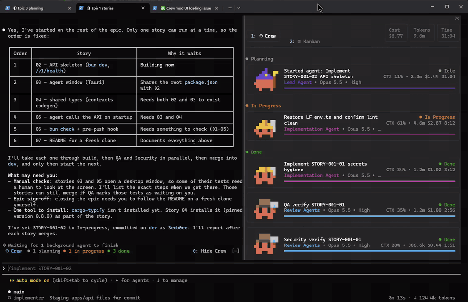
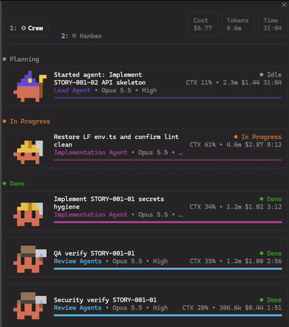
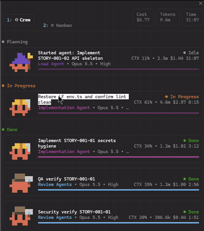
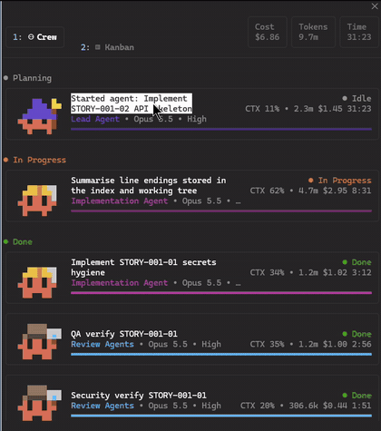

<div align="center">

<h1>crew-kanban</h1>

**See your whole crew at a glance: every agent in your Claude session, what it's doing, which files it's touching, and where each task stands.**

[](mod/crew-kanban/.claude-plugin/plugin.json)
[](#setup)
[](#reference)



</div>

| | | |
|:--:|:--:|:--:|
|  |  |  |
| Your crew at a glance | Every file an agent touched | What each agent did, live |

## What you can do

- 👀 **See who's working.** A band above the prompt sums up the crew. The **Crew** tab groups every agent by status: Planning, In Progress, Done.
- 📊 **Check each agent's progress.** Role, model, effort, context use, tokens, cost and time sit on each agent's card, along with a progress bar.
- 🗃️ **Track the session's tasks.** The **Kanban** tab lists every task the agents work on, in lanes: Planning, Backlog, In Progress, In Review, Blocked and Done. The agents move tasks between lanes themselves as the work changes, and add lanes of their own (QA, Rework, ...) when the work needs one.
- 🗂️ **Watch files change live.** The **Edits** tree shows your project folder. Files an agent changed get an A/M/D badge, and files being written right now shimmer.
- 🌿 **Know which branch you're on.** In a git repository the status line and the pane show the branch, like `◆ main`. If the session moves to another branch it shows where it started and where it is now, `◆ main › ⎇ new-feat`, and `[wt]` marks a linked worktree.
- 📜 **Follow what happened.** Each agent has an **Activity Log**. Each task merges the activity of every agent working on it.
- 🧢 **Tell agents apart.** Every agent is a Clawd mascot whose accessories match its type: a wizard hat for the lead, a detective hat for reviewers, a hard hat for builders, a beret for designers. Claude draws new ones for unfamiliar agent types.

> **Nothing to configure, nothing kept.** Install once, then type `/crew` in any session. Everything it shows comes from the current session and disappears when the session ends. Nothing is written to your project or sent anywhere.

<div align="center">

**⭐ Leave a star if you find this useful**

</div>

---

## Contents

- [Setup](#setup): get it running in about a minute
- [How to use it](#how-to-use-it): the band, the tabs, the lanes and the detail views
- [Things to know](#things-to-know): checking your build, how the code is laid out, making it yours
- [Reference](#reference): terms, options, file locations, troubleshooting, notes for AI agents

---

# Setup

Three steps.

## Step 1 — Install Claude Code

You need [Claude Code](https://claude.com/claude-code) in the terminal or the desktop app. Check that it's there:

```sh
claude --version
```

Crew Kanban is a **mod**: a Claude Code plugin that draws its own interface inside Claude.

## Step 2 — Get the code

```sh
git clone https://github.com/rescueahero4/crew-kanban.git
cd crew-kanban
```

## Step 3 — Add the mod

In a Claude session, add this repo's `mod/` folder as a plugin marketplace, then install the plugin:

```sh
/plugin marketplace add ./mod
/plugin install crew-kanban@crew-kanban-mod
```

Use the path to `mod/` from wherever your session is running. Then type `/crew`. That's it.

<details>
<summary>What this adds</summary>

- a `/crew` command that opens the Crew pane
- a one-line band above the prompt that appears once the session has agents or tool activity
- a `kanban` tool the agents use to keep the board current, and a short note in their system prompt asking them to
- two options, **Reduce motion** and **Desktop column width** (see [Options](#reference))

It doesn't write any files to your project. Everything it tracks is kept in the session's memory.

</details>

<details>
<summary>Updating it later</summary>

The plugin is read straight from the `mod/crew-kanban` folder, so after a `git pull` run `/reload-plugins` (or start a new session) to load the new code. When the version in `plugin.json` changes, `claude plugin update crew-kanban@crew-kanban-mod` records it too.

</details>

---

# How to use it

## Open the Crew pane

Type `/crew`, or click the band above the prompt. Click the band again to close the pane. In the terminal, `1` and `2` switch between the **Crew** and **Kanban** tabs.

| You want to… | Go to |
|---|---|
| See how many agents are working and how far along they are | **Crew** tab |
| See session totals: cost, tokens, time | top of the pane |
| See every task, by lane | **Kanban** tab |
| See which files one agent changed, and what it did | click the agent → **agent detail** |
| See everything that happened on one task | click the task → **task detail** |
| Jump from a task to one of its agents | click the agent's chip in task detail |

## The Kanban lanes

Tasks sit in one of six lanes until an agent decides the work needs another:

| Lane | Means |
|---|---|
| **Planning** | Being scoped or designed; not ready to start |
| **Backlog** | Ready to start, nobody on it yet |
| **In Progress** | An agent is working on it now |
| **In Review** | Built; being reviewed, tested or awaiting sign-off |
| **Blocked** | Waiting on something; the note under the task says what |
| **Done** | Finished and accepted |

You don't move tasks yourself: the agents do, with the `kanban` tool, as the work changes. A task goes to In Review once it's built, back to In Progress if review sends it back, and to Blocked with a note when an agent is stuck. Tasks the agents write with Claude's own task list (TaskCreate, TodoWrite) show up too, in Backlog until they're started.

Empty lanes show as a dimmed heading. Click a lane's heading to fold it away.

## The detail views

- **Agent detail**: the agent's card at the top, with **Edits** on the left and the **Activity Log** on the right. Drag the divider to make either side wider. The log streams in live, newest at the bottom.
- **Task detail**: the task's id, lane, note and title, a chip for every agent on it, and an **Activity** stream that merges all their log entries. A **Live** indicator shows while the task is in progress.
- **Back** returns you to the tab you came from.

> **Tip:** if you scroll up in a live log, new entries won't pull you back to the bottom. Jump to the latest when you're ready.

---

# Things to know

## Check your build

Two commands, run from the repo root:

```sh
claude plugin validate mod/crew-kanban   # reads the manifest and hooks the way the engine will
claude plugin test mod/crew-kanban       # runs hooks/crew.test.tsx against the engine
```

The tests draw every screen on both the terminal and the desktop surface, and cover the lanes: agents adding and moving tasks, adding and removing lanes, and Claude's own task tools leaving a board move alone.

## How the code is organized

One hooks module and the views it draws, all in `mod/crew-kanban/`:

| File | What's in it |
|---|---|
| `hooks/register.tsx` | The event handlers: tool calls, model requests, the roster poll, the `kanban` tool, the band and the pane. |
| `hooks/model.ts` | The data and the pure steps that change it: activity entries, edits, tasks and lanes (`applyTaskTool`, `applyBoard`). |
| `hooks/views.tsx` | The terminal drawing of the pane and the band. |
| `hooks/desktop.tsx` | The Desktop app's drawing, to the mockup's pixels. |
| `hooks/theme.ts` | Colours, labels, the default lanes and the agent roles. |
| `hooks/mascot.ts` | The Clawd mascots and their accessories. |
| `types/index.d.ts` | The shape of everything the mod keeps in session state. |

## Make it your own

- **Change the default lanes**: they're `DEFAULT_LANES` in `hooks/theme.ts`: id, label, colour and the hint the agents read.
- **Change how agents are told to use the board**: the tool's description and the system-prompt note are `BOARD` and `BOARD_PROMPT` in `hooks/register.tsx`.
- **Change how it looks**: the terminal version is `hooks/views.tsx`, the Desktop version `hooks/desktop.tsx`.

---

# Reference

<details>
<summary><b>Terms you'll see</b></summary>

| Term | Meaning |
|---|---|
| **Crew** | All the agents in the current session, including the main session itself. |
| **Band** | The one-line summary above the prompt. Click it to open or close the pane. |
| **Status** | Planning, In Progress or Done, for an agent. |
| **Lane** | Where a task stands on the Kanban tab: one of the six defaults, or a lane an agent added. |
| **Git label** | The branch the session's folder is on, under the tabs and in the status line. `◆ main` is the branch the session started on; `◆ main › ⎇ new-feat` means it has since moved to `new-feat`; `[wt]` (a **wt** tag on Desktop) means a linked worktree. It's read when the session starts, after every shell or worktree tool call, and every 5 seconds. |
| **Note** | A short reason an agent gave for where a task sits, like "waiting for CI". |
| **A / M / D** | Added, modified or deleted, shown next to a file in the Edits tree. |
| **Shimmer** | A file that some agent is writing right now. It stays lit for a moment after the write lands. |
| **Role** | Lead, Review, Implementation or Designer. It's inferred from the agent's type and picks the mascot's accessories. |

</details>

<details>
<summary><b>Options</b></summary>

| Option | Default | What it does |
|---|---|---|
| **Reduce motion** | off | Mascots are drawn still, and files being edited get a static tint instead of the shimmer. |
| **Desktop column width (px)** | 8 | How many CSS pixels one pane column is in the Desktop app; the pixel-drawn parts are sized from it. |

Set them in the plugin's settings in Claude Code.

</details>

<details>
<summary><b>Where your data lives</b></summary>

| What | Where |
|---|---|
| The mod itself | `mod/crew-kanban/` |
| Plugin manifest and options | `mod/crew-kanban/.claude-plugin/plugin.json` |
| Marketplace entry | `mod/.claude-plugin/marketplace.json` |
| The GIFs in this README | `assets/demo/` |
| Product context | `PRODUCT.md` |

Session data (agents, tasks, lanes, edits, activity) is kept only in the session's state. Nothing is written to disk and nothing outlives the session.

</details>

<details>
<summary><b>Troubleshooting</b></summary>

- **I don't see the band.** It only shows up once the session has used a tool or started a subagent. You can still type `/crew` to open the pane.
- **The Kanban tab is empty.** The agents haven't planned any multi-step work yet. Ask for something with a few steps, or ask Claude to put its plan on the board.
- **Tasks don't move.** The agents decide when a task changes lane. If one is stale, tell Claude, for example "move the API task to In Review".
- **There's no git label.** The session's folder isn't in a git repository, or `git` isn't on the PATH.
- **The Edits tree is missing a folder.** `.git` and `node_modules` are skipped on purpose.
- **The motion is distracting.** Turn on **Reduce motion** in the plugin's options.
- **An agent's mascot looks generic at first.** Claude hasn't drawn accessories for that agent type yet. Until it does, the agent wears a placeholder look.
- **A change to the mod doesn't show.** Run `/reload-plugins`, or start a new session.

</details>

<details>
<summary><b>For AI agents</b></summary>

Facts for agents working in this repo:

- **Plugin:** `mod/crew-kanban/`, registered by `mod/.claude-plugin/marketplace.json` as `crew-kanban` in the `crew-kanban-mod` marketplace. The entry module is `hooks/register.tsx`, listed in `hooks/hooks.json`.
- **Board tool:** the mod registers `mcp__crew-kanban__kanban` (actions `list`, `add`, `update`, `remove`, `add_lane`, `remove_lane`) and adds a short system-prompt section asking agents to keep the board current. It is served in `register.tsx` from `applyBoard` in `model.ts`.
- **State:** all state lives in `atom`s scoped to `crew-kanban` (`crew`, `nav`, `layout`, `isOpen`, `generated`, `looks`). Keep it session-scoped and never persist it.
- **Surfaces:** the `crew` pane is opened by `/crew` or the band, and the band is rendered into `AbovePrompt`. The roster polls every 1s, and the animation repaints every 250ms unless `reducedMotion` is on.
- **Tests:** `hooks/crew.test.tsx`, using `claude-code/testing`.
- **Design first:** this project uses **design-recall**, kept locally in `.design-recall/` (not in the repo). Mockups there define the UX. Change them only through the `design-iterate` skill, and read `.design-recall/context/design-principles.md` before any design work. Never run plain `git` against `.design-recall/`. See `CLAUDE.md`.

</details>

---

<div align="center">


Found it useful? [⭐ Star it](https://github.com/rescueahero4/crew-kanban) or share it with someone running a crew of their own.

</div>
